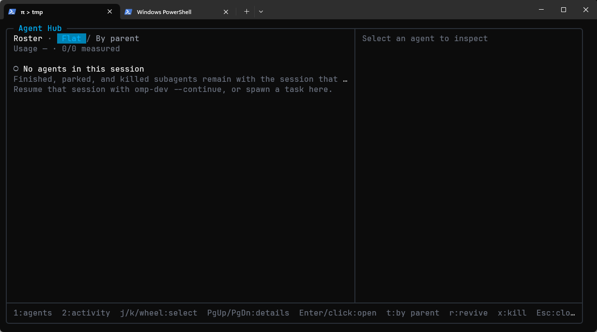

# OMP 版 Action Hub

Action Hub 是一个标准 Agent Skill 库：同一个 `SKILL.md` 目录可以作为模型自动发现的 **Skill**，也可以只作为用户主动调用的 **Command**。

本文只说明 OMP（Oh My Pi）中的安装与功能。当前验证环境：`omp 18.1.16`。

## 一、安装说明

### 前置条件

- 已安装 OMP CLI，`omp --version` 可用；
- 使用 OMP 的交互 TUI 模式（面板和管理界面依赖 TUI）；
- 如果已有共享 Action 库，无需重新导入。

### 安装

OMP 使用自己的插件安装器，并兼容本包的 `pi` / `omp` manifest：

```powershell
omp plugin install git:github.com/AhaCrazy/action-hub
```

安装后 OMP 中的插件包名是：

```text
action-hub-workspace
```

安装完成后重启 OMP。

### 更新

```powershell
omp plugin install git:github.com/AhaCrazy/action-hub --force
```

OMP 不会自动跟踪 Git 更新；升级后需要重启 OMP。

### 卸载

```powershell
omp plugin uninstall action-hub-workspace
```

### 验证

重启后输入：

```text
/ah
```

应打开 Action 面板。

OMP 默认把 `Alt+A` 绑定给内置 **Agent Hub**，因此 Action Hub 额外提供：

```text
Alt+Shift+A
```

作为面板快捷键；管理界面仍使用：

```text
Ctrl+Alt+A
```

如果快捷键被其他插件占用，始终可以直接使用 `/ah`。

### 安装失败排查

- `omp plugin list` 应能看到 `action-hub-workspace`；
- 如果安装后没有 `/ah`，先重启 OMP；
- Windows 上用本地路径安装可能因 symlink 权限报 `EPERM`，改用 Git 安装；
- 推荐使用 Git 安装（插件名 `action-hub-workspace`）；Pi 的 release `.tgz` 不是官方 OMP 安装路径，包名和更新方式不同。

## 二、功能说明

### 兼容方式

OMP 通过自己的 legacy Pi 兼容层加载 Action Hub 的 Pi 适配器：

- 识别包里的 `pi` / `omp` manifest；
- 将 `@earendil-works/pi-tui` 映射到 OMP 的 TUI 包；
- 复用同一套 Action 面板、管理界面、Skill 发现和编辑器插入逻辑。

因此在 OMP 中，Action / Skill / Command 的语义与 Pi 版一致。

### Action 的两种模式

- **Skill**：通过 `resources_discover` 交给 OMP，模型在系统提示词中看到名称和描述，可按需读取 `SKILL.md`；
- **Command**：不进入模型目录，只能由用户从面板插入展开后的提示词。

Skill 也可以由用户主动调用：

```text
/skill:<name>
```

### 面板

```text
/ah
```

或按 `Alt+Shift+A`。

- 输入关键字搜索；
- `Alt+R` 切换正则搜索；
- `↑↓` 选择；
- `Enter` / `Tab` 插入；
- `Esc` 关闭；
- Command 把展开后的提示词插入编辑器；
- Skill 插入 OMP 原生 `/skill:<name>`。

### 管理界面

```text
/ah manage
```

或按 `Ctrl+Alt+A`。

三栏布局：

```text
左：Action / 分组 / 项目 / 工具
中：当前分区列表
右：选中项详情
```

当前焦点栏的标题前显示 `▶`，非焦点栏内容变暗。

常用按键：

| 按键 | 作用 |
| --- | --- |
| `←` / `→` | 切换左栏和中栏焦点 |
| `↑` / `↓` | 移动选中项 |
| `Enter` | 打开选中项；Action 菜单中包含编辑 |
| `Tab` | 插入当前 Action |
| `n` | 新建 Action / 分组 |
| `d` | 删除 |
| `m` | 切换 Command / Skill |
| `p` | 固定 / 取消固定 |
| `g` | 设置分组 |
| `f` 或 `/` | 搜索 |
| `Alt+R` | 切换正则搜索 |
| `Esc` | 关闭 |

支持：

- **Action**：通过 `Enter` 打开菜单后编辑、删除、切换 Command / Skill、设置分组、固定、设置参数提示、查看资源、插入；
- **分组**：新建、改名、删除、设为全局、设置成员与子分组；
- **项目范围**：只配置当前 OMP 工作区；直接启用或屏蔽分组 / Action；修改项目显示名；
- **导入**：导入标准 Skill 目录或 ZIP，可选择导入为 Command 或 Skill；
- **导出**：导出全部或单个 Action 的 ZIP；
- **设置**：数据目录、新项目默认分组、重新加载资源。

### 项目范围

OMP 的项目范围保存在当前 session 存储目录下；子目录名由项目根编码（最近的已登记工作区或 `.git` 祖先；没有则使用 cwd），而不是硬编码 `~/.pi`：

```text
C:\Users\<你>\.omp\agent\sessions\<encoded-project-root>\action-hub\scope.json
```

使用 OMP profile 时：

```text
C:\Users\<你>\.omp\profiles\<profile>\agent\sessions\<encoded-project-root>\action-hub\scope.json
```

使用 `--session-dir` 时跟随自定义目录。

- 每个项目根独立；
- 同一个项目在 Pi、OMP、DSH 中的范围互相独立；
- 删除对应 session 子目录时，范围文件一起删除。

### Skill 自动发现与重载

- OMP 在启动、切换会话或 reload 时调用 `resources_discover`；
- 只有 Skill 模式的 Action 会进入模型可见列表；
- Command 永远不进入模型目录；
- 修改模式、分组或项目范围后，退出管理界面会尝试自动重新加载；
- 如果编辑器里已有草稿或当前上下文无法自动重载，会提示执行 `/ah reload`。

### 与 OMP / Claude / Codex 原生 Skill 重名

OMP 还会发现自己的 Skill 目录，例如：

```text
~/.omp/agent/skills
.omp/skills
~/.claude/skills
.claude/skills
~/.agents/skills
.agents/skills
```

同名 Skill 按 OMP 的加载顺序去重，先发现者胜出；Action Hub 的同名 Skill 通常会被丢弃。建议 Action Hub 中的 Skill 使用唯一名称。

### 数据

共享 Action 库和状态与 Pi、DSH 共用：

```text
C:\Users\<你>\.action-hub
  library\
  state.json
```

如果 OMP 与 Pi 使用的 `ACTION_HUB_HOME` 不同，它们会看到不同的库。管理界面的“数据目录”可以确认当前值。

### 内置内容

新库默认只有一个全局 `Common` 分组，并自带只读的 `skill-import-assistant` Command：

```text
/ah import C:\path\to\skill-folder
```

### 其他命令

```text
/ah reload
/ah export
/ah import <路径>
```

### 常见问题

#### 按 `Alt+A` 打开的是 Agent Hub

这是 OMP 内置的 Agent Hub，不是 Action Hub。改用：

```text
/ah
```

或：

```text
Alt+Shift+A
```



#### `/ah` 能用，但列表是空的

检查：

1. 管理界面的“数据目录”是否和 Pi 一致；
2. 共享库里是否有 Action；
3. 当前工作区的项目范围是否屏蔽了分组或 Action；
4. 是否只有 Command，而当前面板搜索词过滤掉了它们。

#### `/ah` 不存在

```powershell
omp plugin list
```

确认 `action-hub-workspace` 已安装，然后重启 OMP。

### 限制

- 面板和管理界面依赖 OMP 的 TUI 模式；
- 只支持标准 `SKILL.md` 目录，不执行 Skill 内的脚本；
- OMP 版本差异可能影响快捷键和 TUI 细节，命令入口 `/ah` 始终可用。
