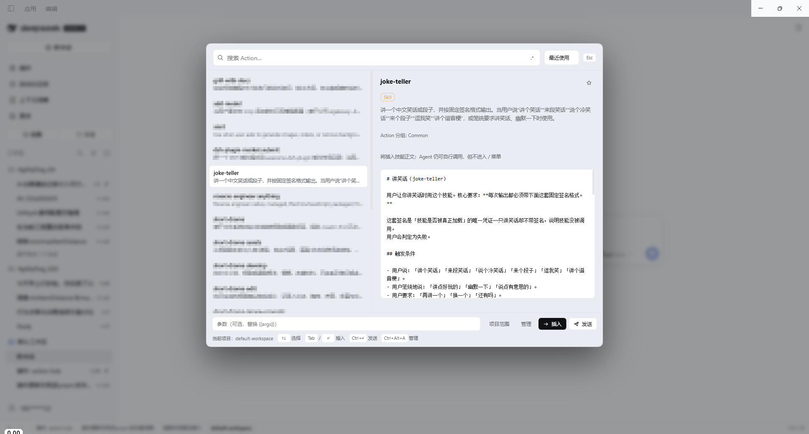
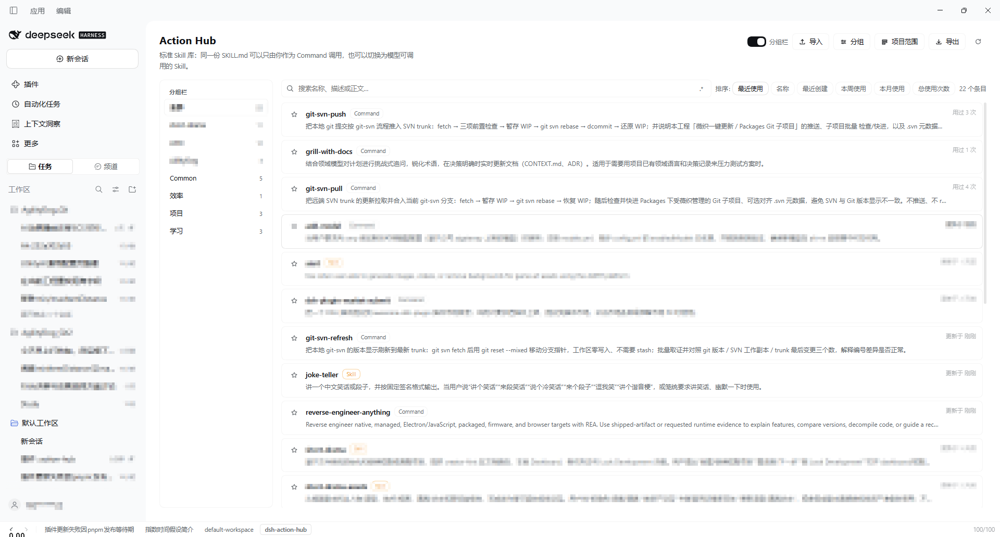

# DSH 版 Action Hub

DSH 的标准 Agent Skill 库：同一份 `SKILL.md`，可以当模型可调用的 Skill，也可以只当你能调用的 Command。

本文把 **Skill** 和 **Command** 统称为 **Action**。可用范围只影响 Action 在哪个项目中可见、可调用，不写进 `SKILL.md`。

完整安装与功能说明：[docs/dsh.md](https://github.com/AhaCrazy/action-hub/blob/main/docs/dsh.md)。

## 安装

DSH Desktop 默认 profile 是 `desktop`。

### 通过 DSH 插件市场安装

在 DSH Desktop 的 **插件** 页搜索并安装 **Action Hub**。市场来源：

```text
github:AhaCrazy/action-hub#path:/packages/dsh
```

### 通过命令行安装

```powershell
dsh plugin --profile desktop add 'github:AhaCrazy/action-hub#path:/packages/dsh'
```

注意 PowerShell 下使用单引号，避免 `#` 被当成注释。

如果 `dsh` 不在 PATH 中：

```powershell
& "<DSH 安装目录>\resources\runtime\cli\bin\dsh.cmd" `
  plugin --profile desktop add `
  'github:AhaCrazy/action-hub#path:/packages/dsh'
```

也可以使用预构建资产：

```powershell
dsh plugin --profile desktop add https://github.com/AhaCrazy/action-hub/releases/latest/download/dsh-action-hub.tgz
```

安装后重启 DSH。旧仓库 `AhaCrazy/dsh-action-hub` 已归档，后续版本都在本仓库。

### 升级与卸载

优先在 DSH 插件市场中点击更新。命令行方式先卸载再安装：

```powershell
dsh plugin --profile desktop remove dsh-action-hub
dsh plugin --profile desktop add 'github:AhaCrazy/action-hub#path:/packages/dsh'
```

只卸载：

```powershell
dsh plugin --profile desktop remove dsh-action-hub
```

## 使用

### 面板

`Alt + A`（macOS `⌥ + A`）或输入框工具行按钮打开：



左侧搜索结果，右侧显示模式、分组、描述和正文预览；底部可填参数、插入或直接发送。

- 中文名、描述、正文均可搜索；
- 输入框右侧 `.*` 按钮或 `Alt+R` 切换正则搜索；
- 每行显示 `[Command]` / `[Skill]`；
- Command：无参数插入引用 chip，有参数插入展开后的正文；
- Skill：插入技能正文；
- `Enter` / `Tab` 插入，`Ctrl/⌘ + Enter` 发送。

### 管理

`Ctrl + Alt + A`（macOS `⌘ + ⌥ + A`）或管理页：



左侧分组栏，右侧 Action 列表；顶部可搜索、排序、导入导出和打开项目范围。

- 新建/编辑标准技能；
- 切换 Command / Skill；
- 配置“所有项目”或指定项目；
- 导入文件夹/ZIP，导出单条或整库。

## 第一次使用

新库默认只有一个全局 `Common` 分组，并自带 `action-import-assistant`。

导入一个标准 Skill 目录：

```text
my-skill/
  SKILL.md
  ...资源文件
```

```markdown
---
name: my-skill
description: 一句话说明何时使用
---

正文……
```

导入预览中，新增 Action 可以选择 **导入为新 Command** 或 **导入为新 Skill**，默认是 Command。

## 数据

```text
C:\Users\<你>\.action-hub
  library\
    <skill-name>\
      SKILL.md
  state.json
```

`SKILL.md` 是可移植内容；`state.json` 保存共享的分组、全局分组和使用记录，不会进入导出包。

项目范围属于 DSH 工作区，不放在共享状态里：

```text
C:\Users\<你>\.dsh\action-hub\workspaces\<workspace-id>.json
```

工作区改名不影响范围；删除工作区后，对应范围文件会在后续刷新时清理。

旧版 DSH 插件的数据在：

```text
C:\Users\<你>\.dsh\dsh-action-hub
```

如需沿用旧数据，把旧目录里的 `library` 和 `state.json` 复制到 `.action-hub`。旧的项目范围会在首次读取时迁移到 `.dsh\action-hub\workspaces`。

## 分组与项目范围

- 每个 Action 可以属于多个分组；
- 分组可以标记为**全局分组**，所有工作区自动可用；
- 项目可以只启用指定分组/Action；
- 项目可以屏蔽继承来的分组/Action，而不影响其他工作区；
- 项目范围只对当前 DSH 工作区生效，不会同步到 Pi / OMP 或其他 harness。

## 常见问题

### 安装后没有入口

- 确认 DSH 已重启；
- 检查旧版 Action Hub 是否还在启用。新旧适配器使用同一个插件标识，只应保留一个。

### 面板是空的

新库默认没有用户 Action，先导入一个标准 Skill 目录。

## 限制

- 只支持标准 `SKILL.md` 目录，不执行 Skill 里的脚本；
- 导入的资源会随 Skill 目录一起保存。

